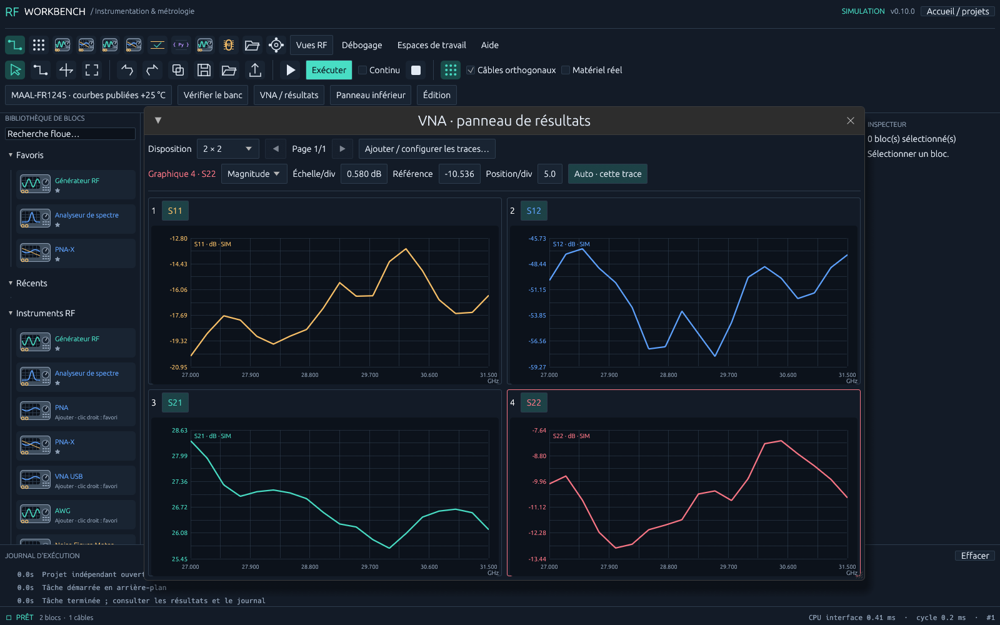
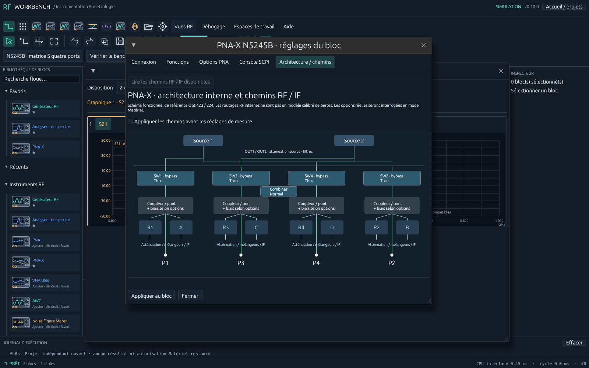

# RF Workbench 0.10 — plan PNA et courbes du catalogue

## Mesures, fenêtres et traces

Le bloc PNA possède désormais un plan commun aux acquisitions, au simulateur et au panneau de résultats. Dans **Fonctions**, choisir **Paramètres S · 4 fenêtres** : un canal, quatre fenêtres en 2 × 2, une trace par fenêtre, dans l'ordre **S11, S12, S21, S22**, toutes en dB. Cocher/décocher les paramètres sélectionne les acquisitions ; **Superposer les traces** conserve une échelle indépendante pour chaque trace. La trace active définit les graduations visibles.

Le preset **Puissance · gain / réflexion / récepteurs** définit un sweep de puissance à fréquence CW. Avec source P1 et réception P2 : S21, S11, R1_1 et B_1. Le gain est en dB ; les récepteurs sont en dBm. Modifier le port source reconstruit un plan compatible. Ce mode Standard reste distinct d'une application GCA, NF ou IMD sous licence.

En matériel, **Configurer canal / écran / chemins (sans sweep)** prépare le canal Standard existant, les traces et fenêtres, le chemin demandé, la fréquence, les points, l'IFBW, la puissance, le moyennage et le CalSet sélectionné. **Appliquer le balayage avant acquisition** utilise le même chemin de configuration lors de Run. **Déclencher** lance un seul sweep, partagé par toutes les traces. Les réglages acceptés sont relus ; un écart empêche le déclenchement. Sans application des réglages, un nouveau sweep exige aussi que les réglages effectifs correspondent au projet.

L'acquisition utilise SDATA complexe pour les paramètres S et FDATA MLOG/dBm pour les récepteurs. Axes en REAL64, amplitudes en REAL32 ou REAL64 ; le format de transfert précédent est restauré. La configuration d'affichage utilise des noms RFW réservés et les numéros de fenêtres choisis. Elle remplace les traces affichées dans ces fenêtres sans preset ni suppression des mesures/calibrations. Les autres fenêtres restent présentes : TILE peut alors montrer plus de quatre fenêtres. Les choix locaux de format/échelle des résultats sont repris dans le plan pour la prochaine configuration.

## Architecture interne et Path Configurator

L'onglet séparé **Architecture / chemins** montre un schéma fonctionnel du PNA-X : sources, sorties, bypass, combiner, coupleurs/ponts, références R1–R4, récepteurs A–D et chaîne IF. L'ordre physique est P1, P3, P4, P2 à quatre ports. Les éléments disponibles peuvent être modifiés dans le schéma ou dans la liste RF/IF.

En simulation, le schéma est une référence 423/224 : il n'est pas une mesure de l'architecture ou des pertes d'un exemplaire. Les positions des commutateurs sont enregistrées, mais ne constituent pas un solveur RF calibré de l'instrument. En matériel, **Lire les chemins RF / IF disponibles** interroge le catalogue du canal, ses réglages possibles et leur état. Les éléments non rapportés restent désactivés. Une configuration enregistrée sur le PNA peut être rappelée, puis des overrides explicites sont appliqués et relus.

Cocher **Appliquer les chemins avant les réglages de mesure** pour envoyer ces réglages lors d'une configuration. Le rappel intervient avant fréquence/IFBW/puissance/calibration, car il peut remplacer les réglages IF. **Combiner** et **Port2Src** peuvent décrire un changement de jumpers : le logiciel ne déplace pas ces câbles. Respecter le texte de connexions physiques indiqué par l'instrument.

Références officielles : [schéma haute puissance](https://helpfiles.keysight.com/csg/NA520xA/Tutorials/High_Power_PNA-X.htm), [Path Configurator](https://helpfiles.keysight.com/csg/NA520xA/S1_Settings/Path_Configurator.htm), [commandes des chemins](https://helpfiles.keysight.com/csg/NA520xA/Programming/GP-IB_Command_Finder/Sense/Path.htm), [affichage SCPI](https://helpfiles.keysight.com/csg/NA520xA/Programming/GP-IB_Command_Finder/Display.htm).

## Données de DUT publiées

Le catalogue embarque désormais des jeux de courbes, copiés dans chaque DUT et intégrés au `.rfbench` :

| Produit | Données récupérées | Conditions et limites |
|---|---|---|
| MAAL-FR1245 | S11, S12, S21, S22 et NF ; 19 fréquences de 27 à 31,5 GHz | Tracé vert +25 °C, PCB avec deembedding, VD +1,5 V, VG −1,5 V, ID 48 mA ; numérisation vectorielle page 4, rev. V4. |
| CGY2170YHV/C1 | S11, S12, S21 et S22 ; neuf fréquences de 8 à 12 GHz | Lecture approximative du graphique page 9, rev. V3 ; carte +25 °C, toutes phases, atténuation de référence pour S21/S12. Le graphique ne détaille pas chaque code ni le mode T/R. |

Sources : [fiche MAAL-FR1245](https://cdn.macom.com/datasheets/MAAL-FR1245.pdf), [fiche CGY2170YHV/C1](https://cdn.macom.com/datasheets/CGY2170YHV-C1.pdf).

Dans le DUT, activer **Simuler avec les courbes publiées / importées**. Les valeurs sont interpolées linéairement dans leur unité publiée, sans extrapolation. Les points d'origine sont conservés avec URL, page, révision, conditions et méthode de récupération. La précision du dessin limite la précision du jeu de données ; ces courbes typiques ne sont pas une mesure de votre DUT. Les valeurs scalaires restent disponibles en désactivant cette option. Une mise à jour du catalogue complète les anciennes fiches constructeur dépourvues de courbes sans remplacer leurs valeurs personnalisées.

Le VNA câblé au DUT utilise ces données, y compris avec câblage inversé. Les courbes additionnelles publiées, comme NF, apparaissent dans la liste des résultats simulés. L'atténuation de corechip est un décalage nominal ; elle ne reconstitue pas les erreurs de chaque état. La compression en sweep de puissance reste une estimation paramétrique, distincte d'une courbe de puissance réellement publiée.

**Aucune phase ni impédance complexe n'est inventée.** Ces deux fiches fournissent ici des modules : Smith, phase et deembedding ne peuvent pas en être déduits. Un message l'indique sur le graphique. Pour un modèle complexe, importer un fichier local **.s2p** ; sa référence d'impédance est conservée et doit correspondre à celle du VNA simulé. Une référence différente nécessite une renormalisation extérieure. Un jeu structuré **.json** peut également être importé depuis le bloc DUT. Aucun scraping ou téléchargement n'a lieu au lancement de l'application.

## Vérification et exemples

Les tests couvrent : ordre des quatre traces, canal commun et sweep unique ; récepteurs binaires ; chemin indisponible et réglage IFBW non accepté ; échelles indépendantes ; restitution des points publiés, absence de phase, câblage inversé et sauvegarde des données. Le vérificateur utilise les ports source sélectionnés et contrôle aussi le retour vers le VNA. Pour un jeu de courbes, son gain maximal est utilisé de façon conservative dans l'estimation de puissance.

Ces commandes sont validées sur des sessions SCPI factices. Le N5245B physique, son firmware, ses options et ses calibrations restent à qualifier sur votre banc. Les états de chemins simulés n'ajoutent aucune précision métrologique au modèle de DUT.
