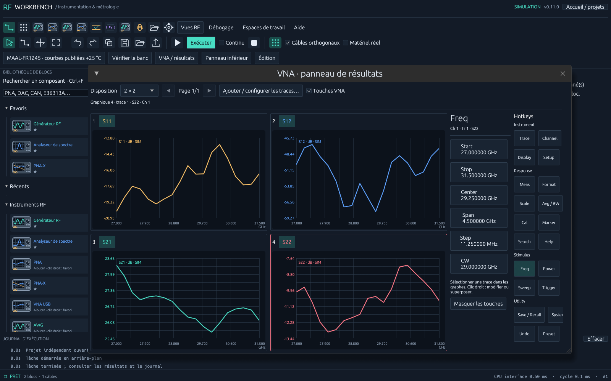
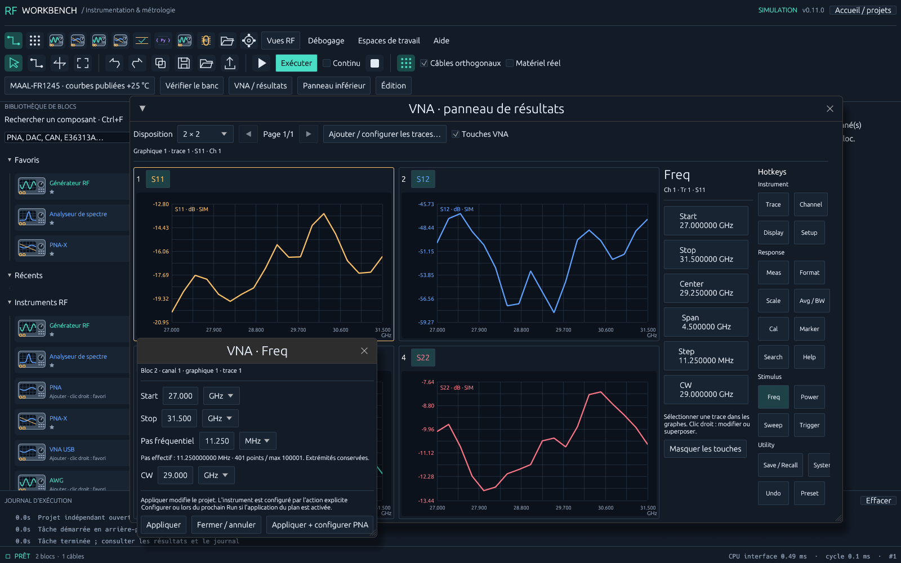

# RF Workbench 0.11 - ergonomie du VNA virtuel

La bibliothèque de gauche et la vue **Blocs** proposent une barre **Rechercher un composant**, un bouton d'effacement et **Ctrl+F**. Les noms directement correspondants passent avant les correspondances floues. Cliquer un résultat attache un aperçu au pointeur ; le clic suivant dans la grille choisit sa position.

En mode **W**, l'aimantation des pins compatibles utilise environ 19 points logiques à zoom 1. A l'entrée du rayon, l'application demande au système de déplacer réellement le pointeur sur le pin. Elle ne répète pas ce déplacement tant que le pointeur reste dans le rayon : il peut sortir librement puis rentrer de nouveau. Les pins occupés, incompatibles et le bloc source sont exclus. Le déplacement natif est disponible sous Windows ; les systèmes qui refusent le repositionnement conservent le repère visuel et la connexion aimantée.

## Modifier et superposer des traces

Cliquer une légende ou près d'une courbe la rend active. Un **clic droit** sur sa légende, ou dans le graphe, donne accès à la mesure, au format, à la visibilité, à l'échelle, au retrait et à **Ajouter une trace dans cette fenêtre**. Les paramètres S et récepteurs proposés dépendent du nombre de ports et de la source du sweep de puissance. Chaque trace conserve sa couleur et sa transformation verticale ; la trace active définit les graduations visibles. Une trace absente demande un nouveau Run pour obtenir ses données.

## Touches à droite

Les boutons sont répartis en Instrument, Response, Stimulus et Utility. Une colonne de paramètres détaille la touche active ; chaque touche ouvre une fenêtre d'édition. Les boutons Start, Stop, Center, Span, Step et CW ouvrent une valeur ciblée avec choix d'unité. La case **Touches VNA** permet de masquer les colonnes.

| Touches | Réglages ou action |
|---|---|
| Trace / Meas / Format | Paramètre, visibilité, module, phase, Smith ou données brutes |
| Scale / Display | Auto, échelle/div, référence, position et grille 1/2/4/6/8 fenêtres |
| Freq / Power / Sweep | Fréquences, pas, puissance, nombre de points et type de balayage |
| Avg / BW / Channel | IFBW, moyennage et canal commun au bloc |
| Marker / Search | Marqueur M1 et recherche du maximum/minimum sur les données affichées |
| Cal / Setup / System | CalSet, fixtures/AFR et dialogue avancé de l'instrument |
| Trigger | Run du banc, application du plan et Stop |
| Save / Recall / Undo | Projet .rfbench et historique des modifications du panneau |
| Help / Preset | Aide du bloc et plan paramètres S par défaut |

**Appliquer** valide les valeurs et modifie le projet. **Appliquer + configurer PNA** configure explicitement le bloc actif. Le prochain Run reprend le plan si l'application des réglages est activée. Un dialogue obsolète ou une configuration invalide est refusé ; fermer/annuler conserve les valeurs précédentes. Le plan est mémorisé avant la configuration et le déclenchement afin d'inclure les traces ajoutées.

Les marqueurs et recherches sont locaux, sans commandes de marqueur envoyées à l'instrument. Smith et phase restent indisponibles pour les courbes de datasheet qui ne publient pas de phase. Preset restaure les traces S11/S12/S21/S22 selon les ports, sans changer le câblage du banc. Les commandes physiques restent testées par sessions SCPI factices ; le N5245B réel reste à qualifier.

Le ZIP Windows contient l'EXE à sa racine, onze projets exemples, ce document et le guide PDF actualisé. Les tests couvrent les vrais clics egui sur traces/hotkeys, la commande de déplacement du curseur et sa sortie libre, la validation des dialogues, l'indépendance des échelles, les marqueurs persistés et l'historique du panneau.
