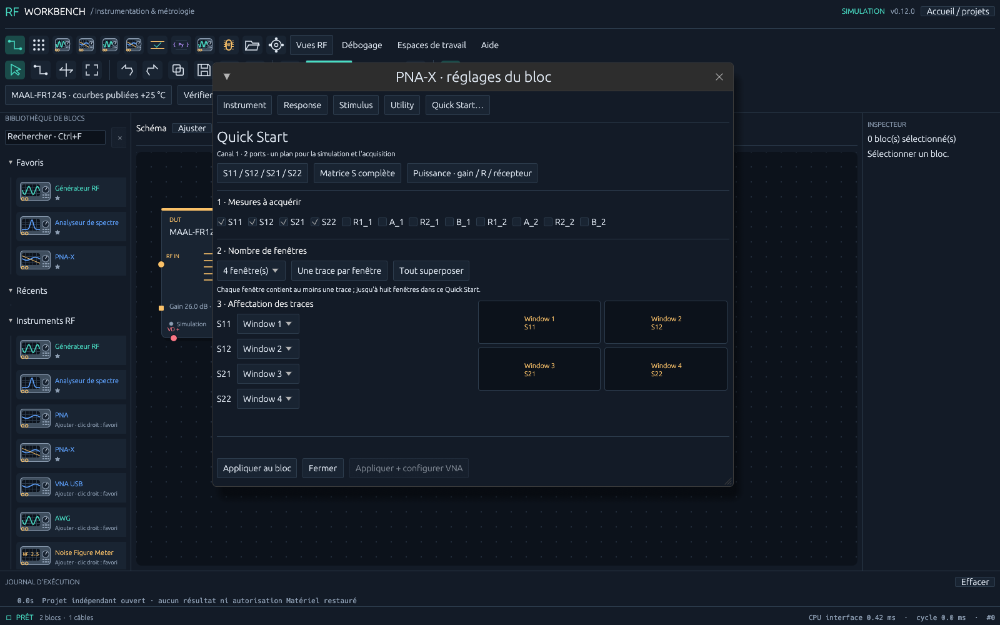
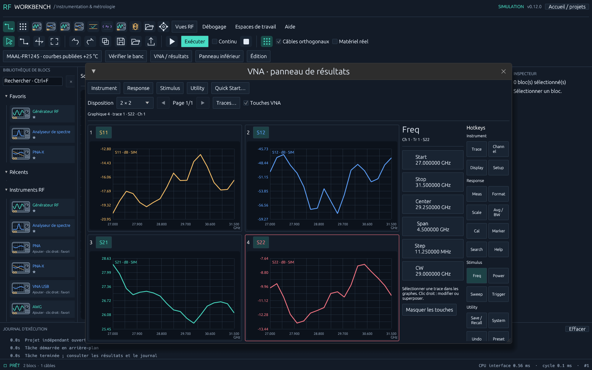

# Version 0.12 : dimensions stables et Quick Start PNA

La bibliothèque de gauche et les résultats VNA restent à la taille choisie. Le champ de recherche est compact ; les catégories longues sont tronquées. Déplacer le séparateur entre bibliothèque et schéma pour ajuster sa largeur (150 à 600 points logiques). Le panneau VNA se redimensionne par ses bords ou son coin ; sa taille minimale est 420 × 300. Les touches défilent à droite et passent sur une colonne lorsqu’il manque de place. Le choix est sauvegardé dans le projet.

## Configuration du bloc PNA / PNA-X / VNA USB

Double-cliquer le bloc : **Quick Start** s’ouvre par défaut. Les menus suivent la hiérarchie de l’instrument :

| Menu | Réglages |
| --- | --- |
| Instrument | Trace, Channel, Window, Display, Quick Start, Meas Class |
| Response | Mesure / format / échelle, Avg BW, calibration et fixtures |
| Stimulus | Freq, Power, Sweep, Trigger |
| Utility | Connexion VISA/SCPI, Path Configurator PNA-X, console |

Le bloc représente **un canal**. Son numéro peut être choisi manuellement ou depuis les canaux détectés. Fréquences, IFBW, puissance et moyennage sont communs à ses traces. Plusieurs fenêtres ne créent pas plusieurs canaux. Les projets existants gardent leurs valeurs et superpositions.

1. Dans Quick Start, prendre le preset **S11 / S12 / S21 / S22**, la matrice S complète ou le preset de puissance à CW.
2. Cocher les mesures compatibles avec les ports et la source. Le preset S utilise cet ordre, une trace en dB dans chaque fenêtre. En puissance, gain/réflexion et récepteurs restent distincts de l’application GCA sous licence.
3. Choisir **1 à 8 fenêtres**, une trace par fenêtre ou tout superposer. Chaque fenêtre contient au moins une trace. La limite générale reste 32 mesures / 16 traces par fenêtre.
4. Régler l’affectation Window de chaque trace. Une trace seule ne peut pas quitter sa fenêtre ; réduire le nombre de fenêtres d’abord. L’aperçu montre le résultat. La répartition conserve les formats et échelles existants.
5. Dans Trace, régler format et échelle de chacune des traces. Les graduations suivent la trace active. Choisir les fréquences et unités dans Freq, IFBW/moyennage dans Avg BW, puissance dans Power, nombre de points et mode dans Sweep, acquisition dans Trigger.
6. **Appliquer au bloc** mémorise le plan et ouvre les résultats locaux. Fermer sans appliquer abandonne le brouillon ; le nombre de ports met toutefois les broches à jour immédiatement, comme auparavant.
7. **Appliquer + configurer VNA** valide et mémorise le même plan, puis configure explicitement l’appareil, sans sweep. Avec Configurer le canal avant Exécuter et Single Sweep activés, Run configure puis acquiert. Les numéros de fenêtres désignés sur l’appareil sont remplacés ; les autres fenêtres/calibrations sont conservées.

Dans les résultats, les menus Instrument / Response / Stimulus / Utility ouvrent les mêmes réglages ciblés que les touches. **Quick Start…** ouvre le brouillon du bloc actif. Le clic droit continue de permettre la modification d’une trace et l’ajout de traces dans le même graphe.

## Vérification et limites

Tests de gestes réels egui : réduction de la palette de 480 à 180 points ; réduction du panneau sur une surface 1280 × 800 avec quatre graphes et touches visibles ; stabilité pendant 60 images après le geste. Tests du Quick Start via clics, conservation des échelles et sérialisation d’un plan à six fenêtres. Les plans alimentent le pilote SCPI existant et la simulation. Le placement des fenêtres sur l’appareil utilise TILE ; les fenêtres étrangères au projet peuvent donc modifier la disposition physique. Le N5245B physique reste à qualifier : cette livraison ne reproduit pas toutes ses applications propriétaires.
